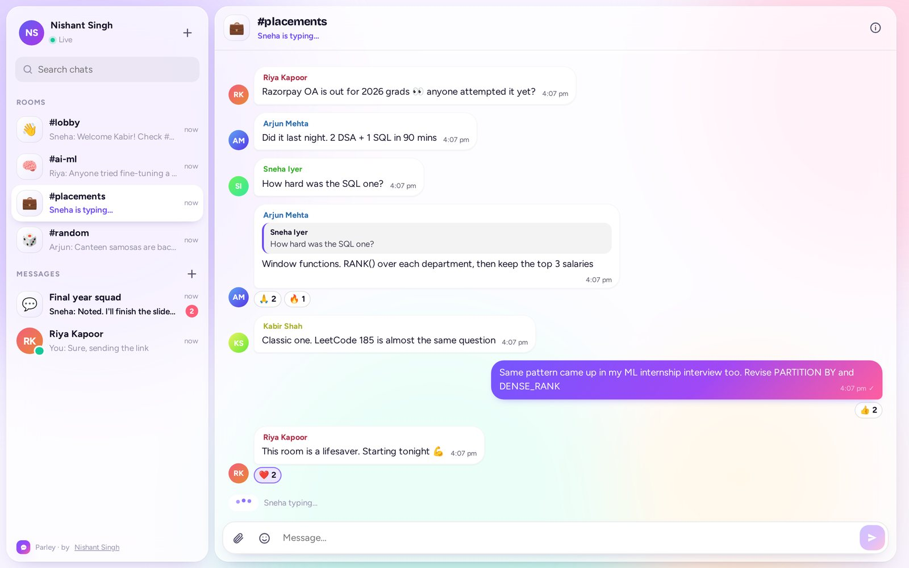
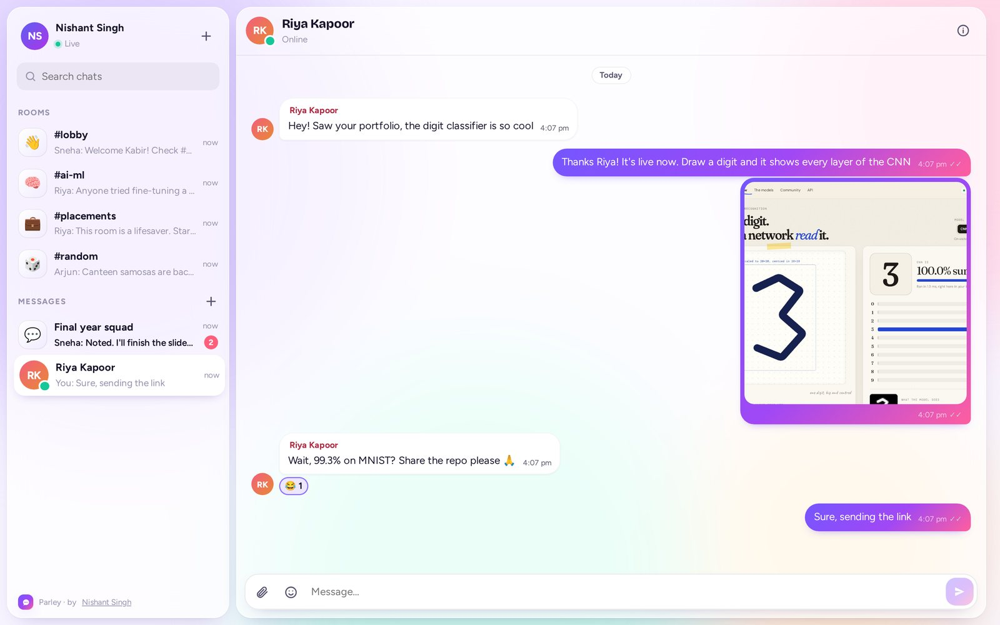
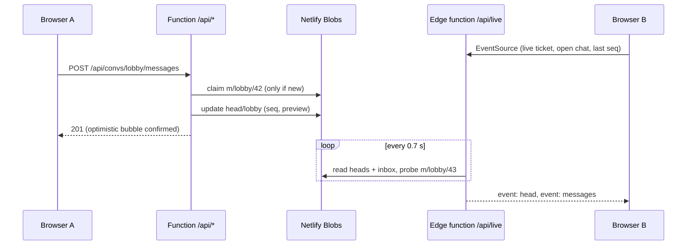
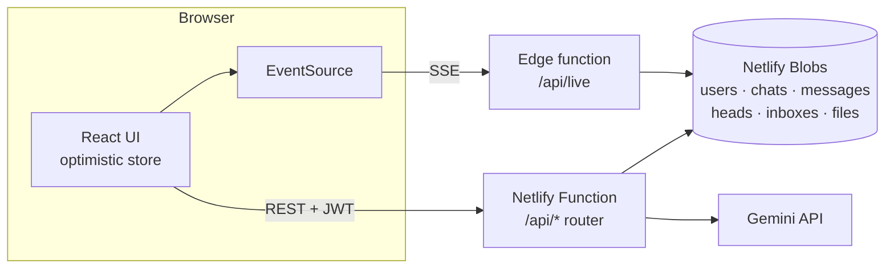

# Parley

**Real-time chat with public rooms, DMs and group chats, and a Gemini co-pilot you can @mention.** Messages, typing indicators, read receipts and reactions reach everyone live, usually in under a second. It runs entirely on Netlify: a streaming edge function for live updates, serverless functions for the API, and Netlify Blobs as the database.

**Live:** https://parley-nishant.netlify.app &nbsp;·&nbsp; **Author:** [Nishant Singh](https://nishant-singhaa0240274.netlify.app)



## Features

**Chat**
- Public rooms (`#lobby`, `#ai-ml`, `#placements`, `#random`), one-to-one DMs and group chats.
- Live typing indicators, online presence, unread badges and ✓✓ read receipts in DMs and groups.
- Emoji reactions, replies with quotes, editing and deleting your own messages.
- Image and file sharing up to 4 MB: attach, paste or drag and drop, with an upload progress bar and a lightbox.
- Optimistic sending: your message appears instantly, then reconciles with the server copy.
- One-click guest accounts with random names, or sign up with a username and password.

**Gemini**
- **@gemini** in any message and Gemini replies in the thread, using the recent conversation as context.
- **Smart replies:** three suggested responses to the latest message.
- **Catch me up:** a summary and key points of what you missed.
- **Translate** any message between English and Hindi.

**Safety**
- Passwords hashed with scrypt; sessions are HS256 JWTs signed with the Web Crypto API.
- DMs and groups are readable only by their members (checked on every API call and on the live stream).
- A word filter masks common English and Hinglish abuse in public rooms.
- Per-user and per-IP rate limits on sign-ups, messages, uploads and AI calls.
- Uploaded HTML, SVG and script files are served as downloads, never rendered.



## How the live updates work

Netlify doesn't run long-lived WebSocket servers, so Parley uses **Server-Sent Events from an edge function**:



- **Ordering without a database server.** Each message is stored under its own key, `m/<chat>/<seq>`. A sender claims the next sequence number with a conditional write (`onlyIfNew`) and reads it back to confirm it won. If another sender got there first, it takes the next number. In the test suite, 40 messages sent at once by three users are all stored, with no gaps or duplicates.
- **Cheap to run.** Edge functions are billed per request, not per second. Each stream lasts 25 seconds and then reconnects, so an open tab costs about 150 stream requests an hour. Background tabs pause their stream after a minute and catch up when you come back.
- **Fallbacks.** If streaming fails three times (for example, behind a proxy that buffers responses), the app switches to polling `/api/sync` every 2 seconds, and the status in the sidebar changes to "Syncing every 2 s".
- **Edits and reactions** bump a revision number on the chat's head document; the stream then sends the changed messages.
- **DMs and groups** also fan out to each member's inbox document, which drives unread badges and makes new chats appear in the sidebar.

## Architecture



| Layer | Technology |
|---|---|
| Frontend | React 18, Vite, Framer Motion, a small `useSyncExternalStore` store |
| Live updates | Netlify Edge Function (Deno) streaming Server-Sent Events, with a polling fallback |
| API | Netlify Functions (Node 22), one router for 24 routes |
| Database | Netlify Blobs (strong consistency, conditional writes) |
| Auth | scrypt password hashes, HS256 JWTs (Web Crypto), short-lived tickets for the stream |
| AI | Gemini API with structured JSON output and a fallback chain across models |

### Data model (Blobs keys)

| Key | Contents |
|---|---|
| `users/<id>`, `handles/<handle>` | Profile and password hash; handle claimed with `onlyIfNew` |
| `d/<handle>~<id>~…` | People directory (search reads key names only, no documents) |
| `conv/<chat>` | Room, DM or group: type, name, members |
| `head/<chat>` | Latest seq, preview, typing, read positions, edit revision |
| `m/<chat>/<seq>` | One message |
| `inbox/<user>` | A user's DMs and groups, with their read positions |
| `presence/<user>`, `file/<id>`, `limit/…` | Last seen, uploads (with metadata), rate-limit windows |

## API

All routes except auth, health and file downloads need `Authorization: Bearer <token>`.

| Method | Path | Description |
|---|---|---|
| `POST` | `/api/auth/signup` · `/login` · `/guest` | Create an account, sign in, or get a guest account |
| `GET` | `/api/bootstrap` | You, your chats with their heads, users, AI status |
| `PATCH` | `/api/me` | Change display name or about |
| `GET` | `/api/users?q=` | Search people |
| `POST` | `/api/convs` | Start a DM `{type:"dm", with}` or group `{type:"group", name, members}` |
| `GET` | `/api/convs/:id/messages?before=|after=` | Page through history (50 at a time) |
| `POST` | `/api/convs/:id/messages` | Send `{text, fileId?, replyTo?, cmid?}` |
| `PATCH` | `/api/convs/:id/messages/:seq` | `{react}`, `{text}` or `{delete:true}` |
| `POST` | `/api/convs/:id/typing` · `/read` | Typing indicator, read position |
| `POST` | `/api/convs/:id/ai/reply` · `/smart-replies` · `/catch-up` | Gemini features |
| `POST` | `/api/ai/translate` | `{text, to: "en" \| "hi"}` |
| `POST` / `GET` | `/api/files` · `/api/files/:id` | Upload (multipart, 4 MB) and download |
| `POST` | `/api/live-ticket` | A 10-minute ticket for the stream |
| `GET` | `/api/live?t=&c=&s=` | The live stream (edge function) |
| `GET` | `/api/sync` | Polling fallback |
| `GET` | `/api/health` | Status and configuration |

## Run it locally

```bash
npm install
npm install -g netlify-cli
netlify dev              # app + API + local Blobs at http://localhost:8888
```

Optional: put `GEMINI_API_KEY=...` in a `.env` file to turn on the AI features.

Local development streams from a Node twin of the edge function (`/api/live-node`, which returns 410 in production), because the Deno runtime for edge functions isn't always available offline. Both use the same code in `shared/live-core.js`.

With `netlify dev` running, run the API tests (39 checks: auth, permissions, concurrency, DMs, groups, reactions, edits, files, moderation, sync):

```bash
python3 tests/api_test.py
```

## Deploy (Netlify free plan)

1. Push this folder to a GitHub repository named `parley`.
2. Netlify → **Add new project → Import an existing project → GitHub** → pick `parley`. Build settings come from `netlify.toml`.
3. Before deploying, add the environment variable `GEMINI_API_KEY` and mark it as a secret.
   - Optional: `JWT_SECRET`, at least 16 characters. Without it, a random secret is generated once and kept in Blobs.
   - Optional: `ADMIN_HANDLES`, a comma-separated list of usernames that can delete any message in public rooms.
   - Optional: `GEMINI_MODEL`, a model to try before the built-in list.
4. Name the project `parley-nishant`, deploy, then click **Make public**.

## Project structure

```
shared/live-core.js       the live stream (used by the edge function and the dev twin)
shared/jwt.js             HS256 sign/verify on Web Crypto (Node + Deno)
shared/constants.js       rooms, limits, reactions
netlify/edge-functions/   live.js: SSE stream at /api/live
netlify/functions/        api.mjs (REST router), live-node.mjs (local dev only)
netlify/lib/              db (Blobs, seq claims, heads, inboxes), auth, ai, gemini, moderation
src/lib/                  store (state + optimistic updates), live (EventSource + fallback), api
src/components/           Landing, Sidebar, Chat + Composer, Message, Panels
tests/api_test.py         end-to-end API tests
```

## License

MIT © Nishant Singh
